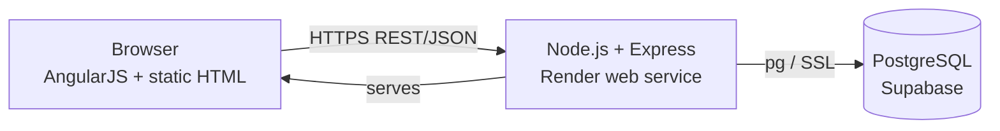
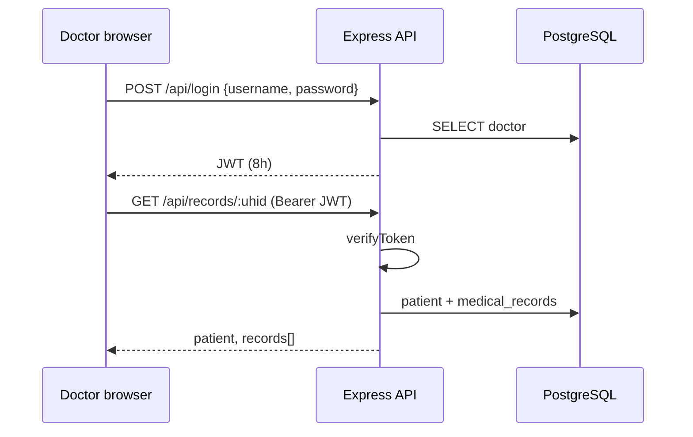

# Technical Design Document – Seva Health

## 1. Overview
Seva Health is a digital health wallet. Patients register once and receive a 4-digit UHID. Authenticated doctors look up a patient by UHID, view the history and add or delete records.

## 2. System architecture


## 3. Doctor login and record access


## 4. Data model
```mermaid
erDiagram
  DOCTORS { int id PK; string name; string username UK; string password_hash }
  PATIENTS { int id PK; string uhid UK; string name; string aadhar UK; string phone; date dob; string gender; text region }
  MEDICAL_RECORDS { int id PK; string uhid FK; text symptoms; text diagnosis; text prescriptions; string added_by }
  PATIENTS ||--o{ MEDICAL_RECORDS : has
```

## 5. API
| Method | Path | Auth | Purpose |
|---|---|---|---|
| POST | /api/login | – | Doctor login, returns JWT |
| POST | /api/patients/register | – | Register patient, returns UHID |
| GET | /api/records/:uhid | JWT | Patient + history |
| POST | /api/records | JWT | Add record |
| DELETE | /api/records/:id | JWT | Delete record |
| GET | /healthz | – | Health check |

## 6. Security
Passwords hashed with bcrypt; JWT signed with `JWT_SECRET`; parameterised SQL everywhere; CORS allow-list; secrets only via environment variables.

## 7. Known limitations / future work
Seeded demo doctors use known passwords (replace for production); no rate limiting; no patient-side login; Aadhar stored in plain text (encrypt for production).
